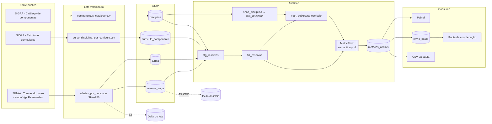

# Catálogo e linhagem: da fonte pública ao consumo (E4)

## Catálogo publicado

O catálogo é o **dbt docs**, publicado junto com o painel em <https://trajetorias-academicas-bd2-2026-2.github.io/Trajetorias-academicas/catalogo/>.

- **Descrição:** toda fonte, modelo, snapshot e coluna têm descrição. O CI roda `tests/catalogo_cobertura.py`, que falha se faltar alguma (160 colunas conferidas).
- **Metadados:** cada item traz `meta` com `dado_pessoal`, `fonte_publica` (página do SIGAA), arquivo do lote e se tem RLS.
- **Exposições:** os consumidores (painel, Pauta da coordenação, CSV da pauta, camada vetorial) estão em `analytics/models/exposures.yml`. São o ponto final do grafo de linhagem.
- **Tabelas fora do dbt:** as gravadas pela camada semântica (`metricas_oficiais`, `metricas_definicoes`) e a fila do ETL reverso (`operations.envio_pauta`) entram como *sources*. Assim, a linhagem não tem buracos.

## Linhagem de ponta a ponta

## Seguindo uma coluna do painel até a origem

**"3.816 lugares guardados para Software no 1º semestre de 2026"** (cena 3 do painel):

| Passo | Onde | O que acontece | Como conferir |
|---|---|---|---|
| 1 | Painel, cena 3 | mostra `serie[].vagas_reservadas` de `/api/observatorio` | abrir `observatorio.json` no Pages |
| 2 | `dashboard/app.py`, consulta `serie` | lê `analytics.metricas_oficiais` onde `metrica = 'lugares_guardados'`, `recorte = 'total'` | `SELECT * FROM analytics.metricas_oficiais WHERE metrica='lugares_guardados' AND curso_codigo='FGA_SOFT' AND semestre='2026.1'` |
| 3 | `analytics/semantica.py` | grava o que o MetricFlow devolve | `mf query --metrics lugares_guardados --group-by reserva__curso_codigo,reserva__semestre` |
| 4 | `models/semantic/semantica.yml` | `lugares_guardados` = soma da medida `vagas` com o filtro `obrigatoria = true` | definição versionada (`meta.versao: 1`) |
| 5 | `fct_reservas.vagas_reservadas` | uma linha por turma × curso; `obrigatoria` vem do currículo de referência de 2026.1 | catálogo, coluna `vagas_reservadas` |
| 6 | `stg_reservas` | junta `reserva_vaga`, `turma`, `curso`, `disciplina` e a natureza no currículo de referência | catálogo, linhagem do modelo |
| 7 | `public.reserva_vaga.vagas_reservadas` | carregado pelo `loader/load_to_db.py`, insert-only | `tests/sanity_checks.sql` |
| 8 | `data/coleta_publica_2026-09-28/ofertas_por_curso.csv`, coluna `vagas_reservadas` | arquivo conferido por SHA-256 antes da carga | `SHA256SUMS.txt` |
| 9 | **SIGAA › Turmas do curso › "Vgs Reservadas"** | página pública da UnB, coletada em 28/09/2026 | `evidencias/sigaa_oferta_curso.jsonl` (URL e horário de cada consulta) |

O mesmo caminho vale para o item da Pauta "Estruturas de Dados 2: 280 lugares guardados para Software". Ele usa `lugares_guardados` com `recorte = 'disciplina:FGA0030'` (passo 2 → `analytics/pauta.py`) e segue igual dali para trás.

**"43 de 55 matérias obrigatórias nunca guardaram lugar" (Eletrônica, cena 6)** segue estes passos:

1. As métricas `obrigatorias_no_curriculo` e `obrigatorias_cobertas` vêm do semantic model `cobertura`.
2. Ele lê `mart_cobertura_curriculo`.
3. O mart vem de `dim_curriculo_componente` (versão de referência) e de `mart_disciplina_semestre`.
4. Esses vêm de `public.curriculo_componente` e `public.curriculo`.
5. Os dois vêm de `curso_disciplina_por_curriculo.csv` e `curriculos.csv`.
6. A origem é **SIGAA › Estruturas curriculares** do curso.

## Onde cada tipo de dado mora

| Camada | Schema / local | Quem lê | Dado pessoal |
|---|---|---|---|
| Fonte | SIGAA (público) | qualquer pessoa | nome de docente |
| Lote | `data/` no git | quem clona o repositório | nome de docente (ver [LGPD](lgpd.md)) |
| OLTP | `public` | só o dono do banco; `auditor_lgpd` vê `docente.id` | nome de docente (coluna bloqueada) |
| Aberto (E2) | `analytical/` (Delta/Parquet, fora do git) | pipeline | não (`qtd_docentes`) |
| Analítico | `analytics` | `painel`, `etl_reverso` e coordenadores **só do próprio curso** (RLS) | não |
| Operacional | `operations`, Pauta (SQLite próprio), `saida/*.csv` | coordenação | não |
